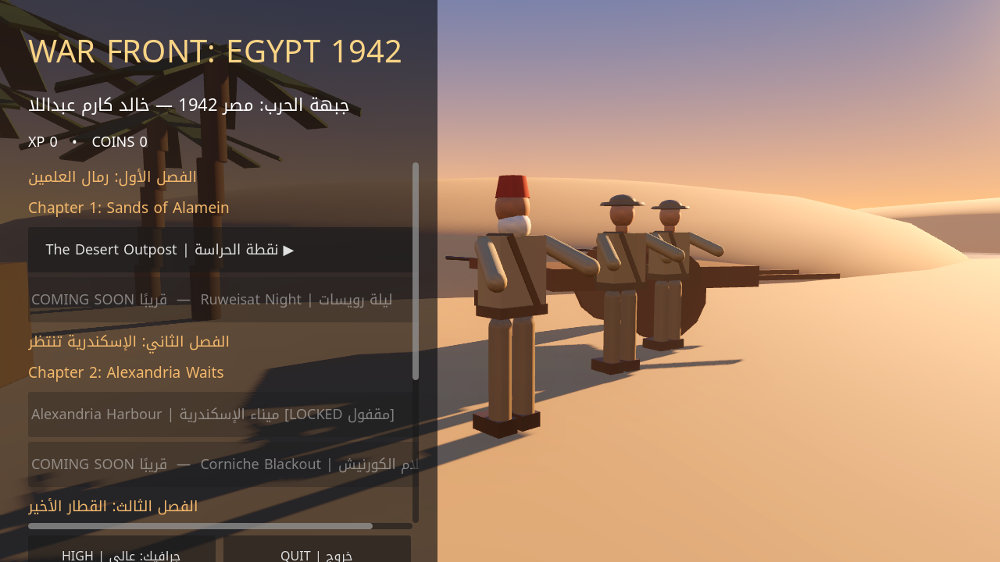
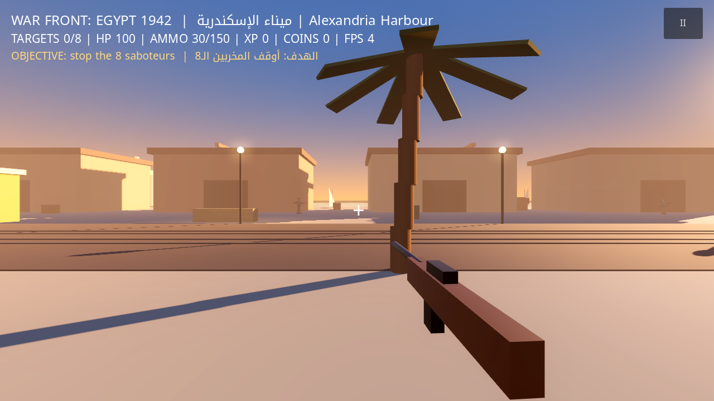
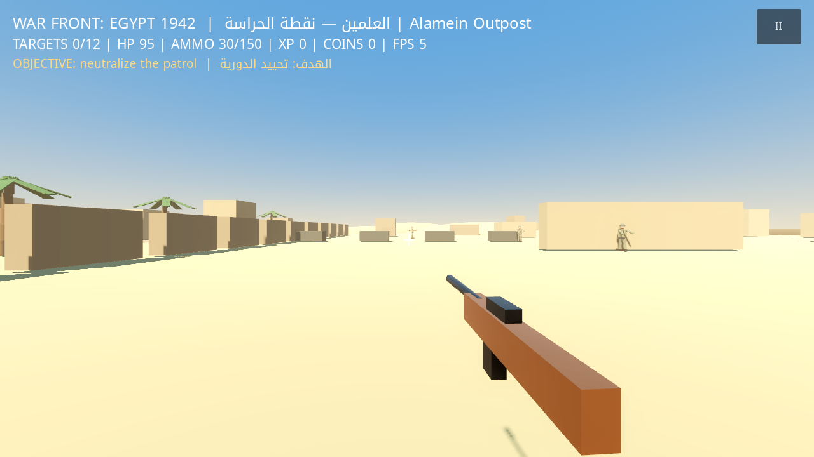
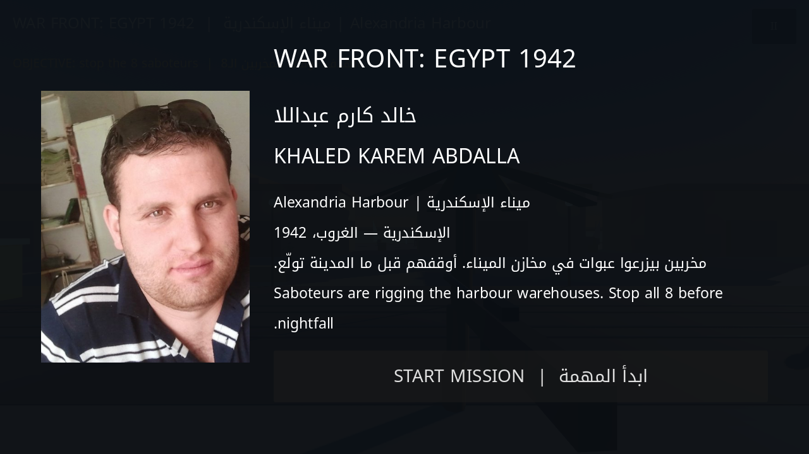

# WAR FRONT: EGYPT 1942 — جبهة الحرب: مصر 1942

Egyptian WWII campaign shooter (Godot 4.3, mobile-first, GL Compatibility).
Hero: **خالد كارم عبداللا** — a desert guide from Alexandria in the El Alamein summer & autumn of 1942.

## Run
1. Install Godot 4.3 → Import → pick `project.godot` → Run (F5). Starts at the campaign menu.
2. PC: WASD, mouse, Shift run, Space jump, LMB fire, RMB aim, R reload, Esc pause.
   Phone: on-screen stick, drag to look, FIRE / AIM / RELOAD / RUN / JUMP.

## What's in the repo
```
project.godot              Godot project (main scene = campaign menu, autoload Campaign)
export_presets.cfg         Android (arm64) debug export
scenes/main_menu.tscn      3D menu: hero Khaled + allies, chapter/mission list, quality toggle
scenes/missions/m01_alamein_outpost.tscn   Mission 1 (original prototype map, now with AI)
scenes/maps/m02_alexandria_harbor.tscn     Mission 2 — NEW map: Alexandria harbour at dusk
scripts/core/campaign.gd   chapters, missions, unlocks, stars, XP/coins save
scripts/core/level_kit.gd  procedural props + environment presets (sky, fog, glow, shadows)
scripts/actors/soldier_model.gd  animated low-poly 3D hero/ally/enemy bodies + rifle
scripts/actors/patrol_enemy.gd   patrol → spot → return fire → search AI
scripts/missions/mission_base.gd shared FPS controller/HUD/touch UI (from the zips' game.gd)
assets/hero/khaled_portrait.jpg  briefing portrait   assets/fonts/  Noto Kufi Arabic (OFL)
assets/shaders/water.gdshader    animated sea
docs/                      story & campaign bible, art direction / 3D pipeline, roadmap, legacy zip notes
.github/workflows/android-apk.yml  CI: headless smoke test → Android debug APK artifact
android-webview/           legacy WebView APK wrapper from the "Cloud APK Build" zip (its index.html was corrupt and is NOT included)
archive/original_zips/     the three original uploads, kept for reference
```

## Build an APK (GitHub Actions)
Actions → **Build Godot 3D Android APK** → Run workflow → download artifact `WAR_FRONT_EGYPT_1942_Godot3D_APK`.
The APK is a debug build for testing, not for the Play Store.

## QA flags (after `--` on the Godot command line)
`--autostart` skip briefing · `--qa-bot` auto-aim test bot · `--report` print result on exit.

## Screenshots (software-rendered on a headless box, real GPUs look sharper)




